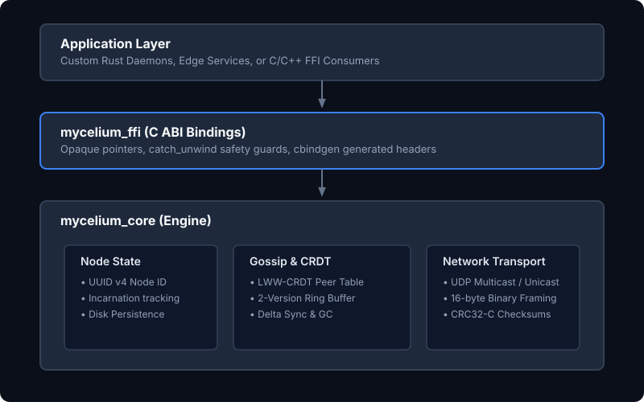
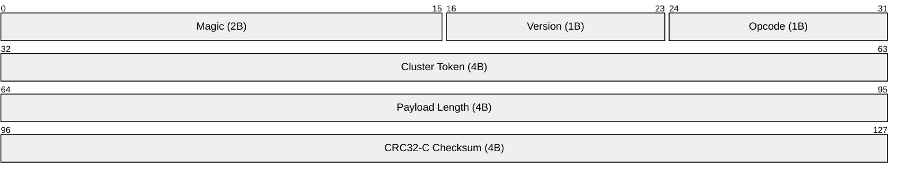

# Mycelium

[](https://github.com/steveSujo/mycelium/actions/workflows/ci.yml)
[](LICENSE)
[](https://www.rust-lang.org)

A decentralized, fault-tolerant LAN peer discovery and state synchronization engine written in Rust.

---

## Overview

**Mycelium** is designed for embedded nodes, local clusters, and edge hardware requiring robust peer-to-peer discovery and convergence without a central coordinator or Raft/Paxos overhead. It seamlessly survives dynamic DHCP IP reallocations and network partitions using an LWW-CRDT gossip architecture.

### Key Features
- **DHCP Survival (Identity from IP)**: Permanent UUID v4 Node IDs with dynamic IP:Port mapping.
- **Unicast-First Architecture**: Low steady-state bandwidth via UDP unicast ping/pong heartbeats; multicast reserved for bootstrap announcements and repair probes.
- **LWW-CRDT Peer Table**: Conflict-free state convergence using `(Incarnation, Timestamp)` tuples, primary-sorted by incarnation to mitigate clock skew.
- **2-Version Ring Buffer**: $O(1)$ memory ring buffer storing current and previous state per node to reject replayed and out-of-order packets.
- **Delta Sync & Tombstone GC**: Bandwidth-efficient incremental updates with a 30s tombstone garbage collection lifecycle (`ALIVE -> SUSPECT -> DEAD -> PURGED`).
- **Zero-Overhead Integrity**: 4-byte Cluster Token and CRC32-C packet header filtering for closed LAN environments.
- **C FFI Support**: Opaque pointer FFI bindings with `catch_unwind` safety guards for embedding in C/C++ applications.

---

## Architecture



### Core Components

| Module | Responsibility | Technology |
|--------|----------------|------------|
| `node` | UUID Node ID generation, Incarnation bump & persistent storage | Rust |
| `net` | UDP socket management, multicast membership, unicast I/O | `socket2`, `tokio` |
| `gossip` | Failure detection, delta sync, ping/pong heartbeats | Rust |
| `crdt` | PeerTable LWW merge, 2-version versioning, tombstone GC | Rust |
| `protocol` | 16-byte binary header, 6 opcodes, CRC32-C checksums | Rust |
| `mycelium_ffi` | C ABI exports, opaque handles, unwind protection | Rust + `cbindgen` |

---

## Quick Start

### Rust Integration

Add to your `Cargo.toml`:
```toml
[dependencies]
mycelium_core = { path = "mycelium_core" }
```

Example usage:
```rust
use mycelium_core::{GossipManager, NetManager, NodeState, DISCOVERY_PORT, MULTICAST_ADDR};
use std::net::{Ipv4Addr, SocketAddr};
use std::sync::Arc;
use tokio::sync::Mutex;

#[tokio::main]
async fn main() -> Result<(), Box<dyn std::error::Error>> {
    let mut node_state = NodeState::init("./mycelium_data");
    node_state.cluster_token = 12345;

    let net_manager = NetManager::new_with_multicast(
        DISCOVERY_PORT,
        Some((MULTICAST_ADDR.parse()?, Ipv4Addr::UNSPECIFIED)),
    )?;

    let gossip_manager = Arc::new(Mutex::new(GossipManager::new(net_manager, node_state)));

    // Receiver loop
    let socket = gossip_manager.lock().await.net_manager.socket.clone();
    let gm = Arc::clone(&gossip_manager);
    tokio::spawn(async move {
        let mut buf = [0u8; 2048];
        loop {
            if let Ok((n, _)) = socket.recv_from(&mut buf).await {
                let _ = gm.lock().await.handle_packet(&buf[..n]);
            }
        }
    });

    // Periodic heartbeat tick
    loop {
        tokio::time::sleep(std::time::Duration::from_secs(1)).await;
        gossip_manager.lock().await.tick();
    }
}
```

### C FFI Integration

```c
#include "mycelium.h"
#include <stdio.h>
#include <unistd.h>

int main() {
    MyceliumInstance* instance = mycelium_init("./data", 12345);
    if (!instance) return 1;

    const char* node_id = mycelium_get_node_id(instance);
    printf("Node ID: %s\n", node_id);
    mycelium_free_string((char*)node_id);

    while (1) {
        mycelium_tick(instance);
        sleep(1);
    }

    mycelium_destroy(instance);
    return 0;
}
```

---

## Build & Test

```bash
# Build workspace
cargo build --workspace --release

# Run unit tests
cargo test --workspace --lib

# Generate C header (requires cbindgen)
cd mycelium_ffi && cbindgen --config cbindgen.toml --output include/mycelium.h
```

---

## Protocol Specification

### Packet Header (16 Bytes)



- **Magic**: `0x4D59` ('MY') (2 bytes)
- **Version**: `0x01` (1 byte)
- **Opcode**: Action identifier (1 byte)
- **Cluster Token**: 4-byte cluster filter
- **Payload Length**: 4 bytes
- **CRC32-C Checksum**: 4 bytes

### Opcodes
| Opcode | Hex | Description |
|--------|-----|-------------|
| `Announce` | `0x01` | Multicast peer announcement |
| `PingUnicast` | `0x02` | Direct node heartbeat ping |
| `PongUnicast` | `0x03` | Direct node heartbeat pong |
| `GossipDelta` | `0x04` | Incremental state update |
| `GossipFull` | `0x05` | Full peer table state sync |

---

## License

MIT License - see [LICENSE](LICENSE) for details.
